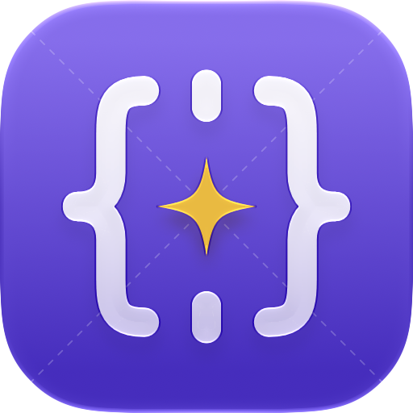
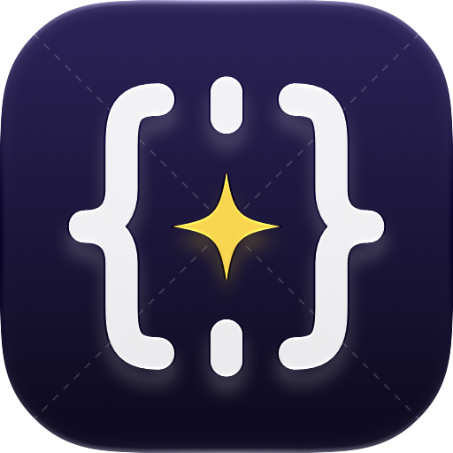

# App icon

The MacScope app icon is a Liquid Glass icon built in Icon Composer. Renders of the default and dark
appearances are in this folder:

| Default | Dark |
|---|---|
|  |  |

The system renders every size and appearance (default, dark, clear, tinted) from the icon's layers.

## Design: brace reticle

A scope's crosshair built from pseudocode braces `{ }`, with Lumen's four-point spark at the
center: looking into a binary and recovering its code. Hairline dashed diagonals behind it give the
field a technical-drawing texture. It follows Apple's HIG for app icons: one idea, few filled shapes,
no painted-on highlights or shadows (the system supplies them), and the same features in every
appearance.

Layers, front to back:

| Group | Layers | Liquid Glass |
|---|---|---|
| 3 Spark | light and dark variants | individual, specular, chromatic shadow 60% |
| 2 Reticle | braces and ticks (opacity 94%, scale 104%) | combined, refraction 80/70, translucency 35% (dark 12%), chromatic shadow 70% |
| 1 Guides | dashed diagonals (opacity 22%, dark 16%) | glass off, no shadow |

Background: Icon Composer gradient fills, never an image.

| Appearance | Top | Bottom |
|---|---|---|
| Default | `#8B6CF2` | `#4A2CC4` |
| Dark | `#2A2156` | `#100C24` |

Colors are Lumen tokens: the spark is `hue.yellow` (standard `#F1B80F`, Midnight `#FFD321` in dark);
the violet field is Lumen's brand violet. All artwork is outlined vector paths (no strokes or text),
as Icon Composer's guide asks.
