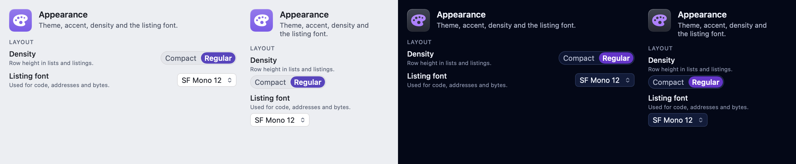
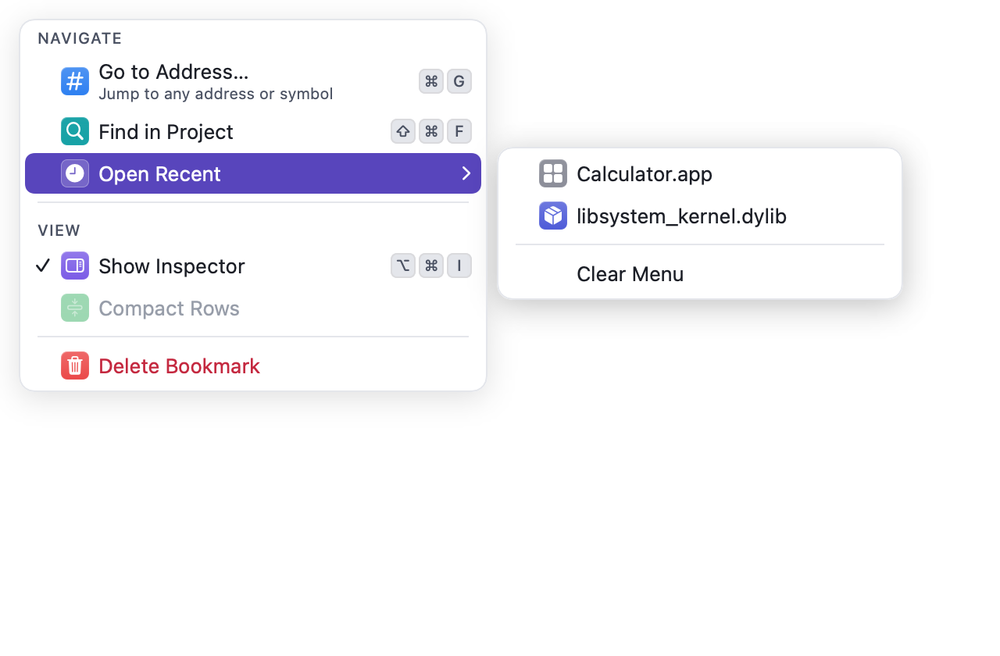
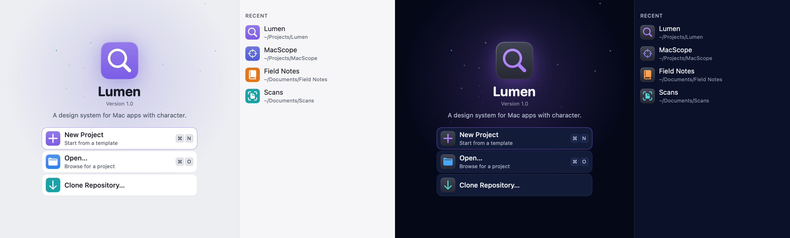
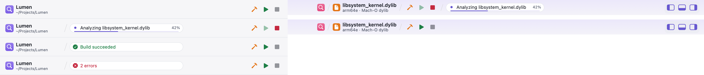
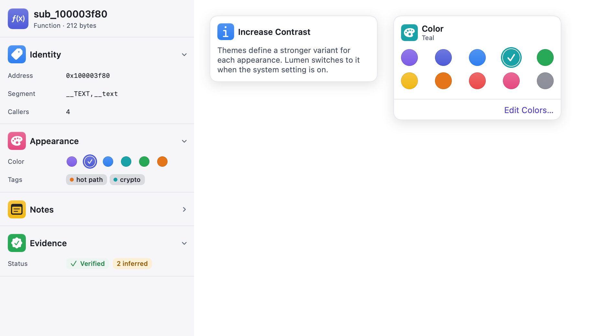
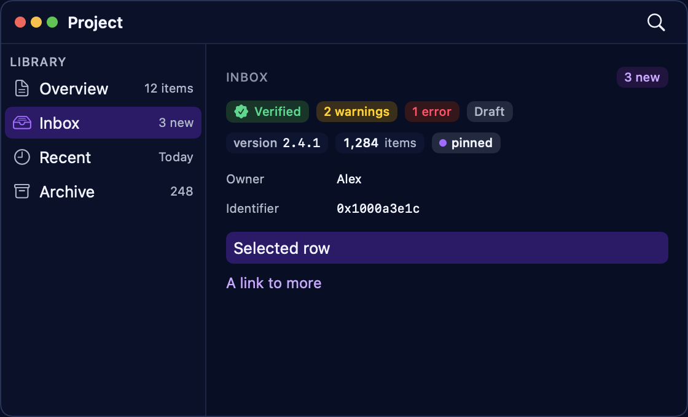
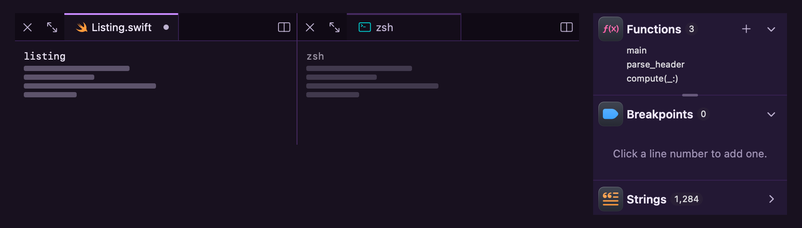
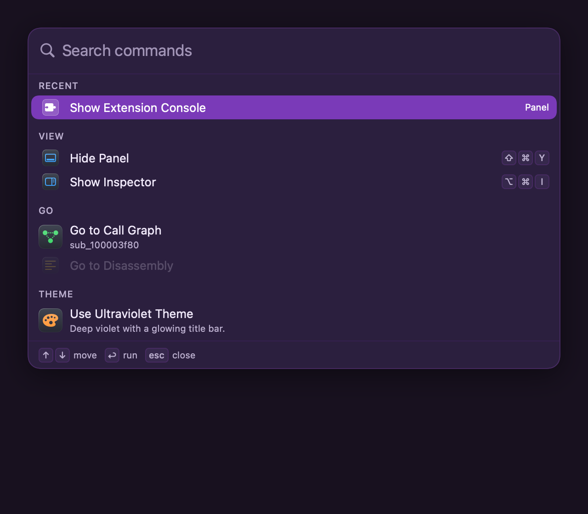
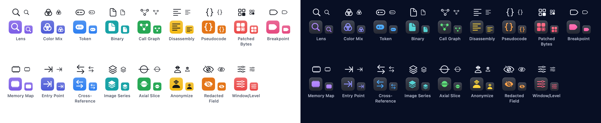

<p align="center">
  
  
</p>

# MacScope

**MacScope's interface and design system, implemented in SwiftUI on synthetic data.**

MacScope is a keyboard-first workbench for inspecting compiled code. This repository contains its
interface: the workspace window with a navigator, editor modes (Disassembly, Pseudocode, Graph, Hex
and a Welcome page), an inspector, a debugger panel and an Appearance settings window. Everything on
screen is synthetic. It is a design implementation only: there is no binary loading, decompiler,
debugger backend, AI, plugin system or networking, and nothing is persisted beyond theme preferences.

The interface is built on **Lumen**, the design system it grew from: semantic color roles, editable
themes with a validator, and a library of native SwiftUI components that other Mac apps can use too.

[Run it](#run-it) · [What's included](#whats-included) · [Components](#components) · [Use Lumen in another app](#adding-lumen-to-an-app) · [Architecture](Docs/ARCHITECTURE.md) · [Changelog](CHANGELOG.md)


## Requirements

- macOS 14 or later
- Swift 6.1 or later toolchain
- Apple frameworks only (SwiftUI, AppKit); no third-party dependencies

## Run it

```sh
swift run MacScope        # the MacScope interface on synthetic data
swift run LumenCatalog    # every Lumen component in working windows, menus and inspectors
swift build               # build all targets
swift test                # run the tests
```

Some tests host real windows, so run them in a logged-in macOS session and leave the screen
unlocked while they run.

## What's included

| Target | Kind | What it is |
|---|---|---|
| `MacScope` | Executable | MacScope's interface on synthetic data: the workspace window, menus and an Appearance settings window |
| `MacScopeShell` | Library | `MacScopeWorkspace`, the workspace window, built from public Lumen API |
| `MacScopeTheme` | Library | MacScope's color pack: its domain roles (syntax, evidence, debug, listing, graph and more), three built-in themes (Scope, Midnight, Contrast) and rules, on top of Lumen's core |
| `LumenTokens` | Library | Tokens, packs, registry, themes, validator and export. Plain Swift, no UI |
| `LumenUI` | Library | Theme store, palette environment, metrics, density, components, the theme gallery, editor and library, and Lumen's custom SF Symbols |
| `LumenConformance` | Library | Design-rule checks an app runs in its own tests: themes, layout, shortcuts, color coverage, the workspace window, truncation, icon scale, overflow, surface steps, tile backlight, visible duplicates and narrow sizing. For test targets only |
| `lumen-theme` | Executable | Validates theme files and exports the token reference, JSON Schema and built-in themes |
| `LumenCatalog` | Executable | A Mac app showing every component, with native menus, a Settings window, a welcome window, a toolbar, an inspector, popovers, the glyphs, and workspace windows |

`Package.swift` is the authoritative list of targets and products.

### Catalog launch options

For screenshots and demos, `LumenCatalog` reads these environment variables, each prefixed
`LUMEN_CATALOG_`: `PAGE=<page>`, `THEME=<theme id>`, `APPEARANCE=light|dark`, `WORKSPACE=1`,
`SPLIT=1` (a window built like MacScope's), `WELCOME=1`, `SETTINGS=1`, `PALETTE=1|<query>`,
`COMMANDS=1`, `POPOVER=1`, `LAUNCH=<seconds>`, `DOCK=1`, `PANEL=<tab>`, `INSPECTOR=0`,
`ACTIVITY=working`, `SCROLL=bottom` and `LOGSTREAM=1` (a log line every 0.3 s).

## Documentation

- [Docs/PRINCIPLES.md](Docs/PRINCIPLES.md): the design principles, compatible with macOS and drawn by Lumen
- [Docs/ARCHITECTURE.md](Docs/ARCHITECTURE.md): layers, the token and theme model, API naming, versioning
- [Docs/KEYBOARD.md](Docs/KEYBOARD.md): keyboard operation, shortcuts, menu bar commands and click targets
- [Docs/DESIGN-BRIEF.md](Docs/DESIGN-BRIEF.md): MacScope's visual system
- [Docs/brand/APP-ICON.md](Docs/brand/APP-ICON.md): the app icon
- [Docs/reference](Docs/reference): the generated token reference, theme JSON Schema and built-in themes
- [Docs/examples](Docs/examples): an example theme file

## Screenshots



| Menus: native menus with tiles, and the command menu | Icon tiles: the hue family |
|---|---|
|  |  |
















## Components

Every view below appears in the Catalog, on its own or inside a larger one, unless it's marked
(not in the Catalog); where to look is in brackets. The theming and layout lines list the APIs
behind them.

- **Chrome & workspace:** `LumenToolbarIdentity`, `LumenActivityStatus`, `LumenTaskCluster`,
  `LumenToolbarBreadcrumb`, `LumenPanelToggles`, `LumenNewItemButton` with `.lumenLaunchMenu`,
  `.lumenWindowChrome`, `.lumenBottomPanel`, `LumenTopBar`, `LumenSplitEditor`, `LumenDocumentTabBar`,
  `LumenTabOverview`, `LumenStatusBar`, `.lumenFloatingStatus`, `LumenWelcomeView`, `LumenWelcomePanel`,
  `LumenStarfield`, `LumenAppIcon`, `LumenWorkspaceWindow` (with `LumenWorkspacePanels`,
  `LumenTopBarPlacement`; not in the Catalog), `LumenWorkspaceToolbar`, `LumenToolbarStatus`, `LumenToolbarDivider`,
  `LumenToolbarGroup`, `LumenNavigationButtons` (not in the Catalog), `LumenContentTabBar`, `LumenTitlebarBackground`,
  `LumenPanelToggle`, `LumenPanelDeckControls`, `LumenWindowDragArea`, `.lumenTopBar`,
  `.lumenToolbarDimming` (not in the Catalog), `LumenToolbarIconButtonStyle` (`.lumenToolbarIcon`),
  `LumenPanelIconButtonStyle` (`.lumenPanelIcon`, `.lumenPanelIcon(isOn:)`), `LumenDropZone` [Toolbar, Welcome, Workspace, Browse (tab overview), States & Rows, Components; the
  Workspace and Split Workspace windows].
- **Sidebars & panels:** `LumenSourceList`, `LumenSidebarSwitcher`, `LumenSidebarSection`,
  `LumenSidebarCountSection`, `LumenStackedSidebar`, `LumenSidebarPaneGrid`, `LumenFilterField`,
  `LumenPanelTabs`, `LumenPanelBar`, `LumenPanelDeck`, `LumenLogConsole`, `LumenLogFilterBar`,
  `LumenSidebarHeader`, `LumenSidebarActions`, `LumenInspector` pieces (`.lumenInspector`,
  `LumenInspectorHeader`, `LumenInspectorRow`, `LumenInspectorToggle`, `LumenInspectorPane`,
  `LumenInspectorSection`, `LumenInspectorSummary`, `LumenReferenceRow`), `.lumenInspectorEmptyState`
  (not in the Catalog), `LumenStatusMenu` [Workspace, Components, States & Rows,
  Editor; the Workspace and Split Workspace windows].
- **Settings & forms:** `.lumenSettingsTab`, `LumenSettingsPane`, `LumenSettingsSidebarView`,
  `LumenSettingsRow` (with a badge), `LumenSettingsCard`, `LumenSentenceRow`, `LumenNumberField`,
  `LumenCheckboxGrid`, `LumenDependentGroup`, `LumenInheritedPicker`, `LumenIntegrationRow`,
  `LumenListEditor`, `LumenMasterDetail`, `LumenFieldList`, `LumenWizardStep`, `LumenManagedToolRow`,
  `LumenAppearanceSettings`, `LumenSettingsHeader`, `LumenSheet`, `LumenFormSection`, `LumenFormRow`,
  `LumenFieldRow`, `LumenInlineField`, `LumenFlowLayout` [Settings, Sheets & Settings, Forms & Controls].
- **Controls & editors:** `LumenSwitch`, `.lumenCheckbox` (`LumenCheckboxStyle`), `LumenRadioGroup`,
  `LumenRadioButton`, `LumenTabbedBox`, `LumenTable` (`LumenTableText`), `LumenSlider`, `LumenTextField` (not in the Catalog),
  `LumenComboField`, `LumenPopUp`, `LumenPopUpLabel`, `LumenPullDownButton`, `LumenKeyValueEditor`,
  `LumenRuleEditor`, `LumenModeSwitcher`, `LumenHelpButton`, `LumenInfoButton`, `LumenHuePickerButton`,
  `LumenHueSwatchPicker`, `LumenColorWell`, `LumenColorGrid`, `LumenSwatchStrip`, `LumenSwatchMenuLabel`,
  `LumenIconPicker`, `LumenPermissionsGrid`,
  `LumenFontPicker`, `LumenCodeFontPicker`; button styles `.lumenPrimary`, `.lumenQuiet`, `.lumenTinted`,
  `.lumenPlain` [Forms & Controls, Popovers, States & Rows, Debugger].
- **Search & navigation:** `.lumenCommandPalette` with `LumenPaletteScope`, `LumenCommandMenu`,
  `LumenMenuLabel`, `LumenFindPanel`, `LumenSearchResults`, `LumenHighlightedText`,
  `LumenInputPalette` with `LumenGoToLine` (`.lumenInputPalette`; `.lumenGoToLine` isn't in the Catalog),
  `LumenCompletionList`, `LumenShortcutRecorder`,
  `LumenFilterChips`, `LumenAddressField`, `.lumenCommandMenu`, `.lumenPanelCommands`, `.lumenPaneCommands`,
  `.lumenMenuOwnsShortcuts`, `.lumenFocusRing`, `LumenViewCommands` (see Docs/KEYBOARD.md) [Menus, Search & Navigation, ⌘K anywhere; the Split Workspace
  window].
- **Data & history:** `LumenNoticeCard` and `.lumenNotices`, `LumenOutlineControls`, `LumenHistoryRow`,
  `LumenRefPill`, `LumenAvatar`, `LumenComparisonHeader`, `LumenDiffNavigator`, `LumenMinimap`,
  `LumenChecklistTree`, `LumenCommitComposer`, `LumenStatsCard` (`LumenStatCell`) [Data & Git; the Split Workspace window].
- **Debugger & code:** `LumenStackFrameList`, `LumenRegisterGrid`, `LumenConsole`, `LumenBreakpointRow`,
  `LumenHexDump`, `LumenCommandField`, `LumenWatchList`, `LumenVariableTree`, `LumenCodeListing`,
  `LumenStatusStrip`, `LumenBranchLanes`, `LumenStringRow`, `LumenStringLiteral`, `LumenGraphNode`
  (`LumenGraphEdgeKind`, `LumenGraphEdgeBadge`), `LumenProcessList`, `LumenVariableRow`,
  `LumenEvaluationResult`, `LumenBreakpointMarker`, `LumenProgramCounterMarker`, `.lumenListingRow`
  (`LumenListingRowState.patchMark`), `LumenHexStyle`, `.lumenCodeFont` (`LumenCodeFont`), `LumenLineNumberRuler` (AppKit)
  [Debugger, Editor, Sheets & Settings].
- **Browse:** `LumenCollection` and `LumenCollectionControls`, `LumenCarousel`, `LumenItemCard`,
  `LumenDetailHeader` [Browse].
- **States & feedback:** `LumenBadge`, `LumenPill`, `LumenTag`, `.lumenTagTint` (not in the Catalog), `LumenCount`,
  `LumenSectionHeader`, `LumenSymbol`, `LumenSymbolBadge`, `LumenSentenceText`, `LumenKeycap`, `LumenEmptyState`
  (`LumenEmptyState.Prominence` `.inline`/`.pane`, `LumenEmptyState.inline(_:ink:leading:padding:)`,
  `.lumenEmptyMessage`), `LumenEmptyHero`, `LumenBanner`, `LumenLoadingState`, `LumenErrorState`, `LumenProgressBar`,
  `LumenProgressRing`, `LumenListRow` (`LumenRowState`, `.lumenRowBackground`), `LumenPropertyRow`,
  `LumenStatusRow`, `LumenCodeSample`, `LumenStatusLabel`, `.lumenPopover` (`LumenPopoverContent`), `.lumenCompactControl`
  (not in the Catalog), `LumenIconTile`, `LumenGlyph` (`LumenGlyphView`) [Components, States & Rows, Forms & Controls, Popovers,
  Icon Tiles, Glyphs].
- **Theming:** `LumenThemeStore`, `.lumenPaletteRoot`, `.lumenMetrics`, `.lumenDensityRoot`,
  `.lumenSurface`, `LumenThemeGallery` (with `LumenThemeCard`, `LumenThemeMiniature`, `LumenThemeEditor`
  and theme import), `LumenUserThemeLibrary`, `LumenShowcase` [Themes].
- **Surfaces & depth:** `.lumenCard`, `.lumenRaisedGround`, `.lumenElevation` (`LumenElevation`),
  `.lumenGlow`, `.lumenTileBacklight`, `.lumenAmbientWash` (`LumenAmbientWash`) [Components, Welcome,
  Workspace].
- **Layout and rules:** `LumenLayout`, `.lumenColumn`, `.lumenSidebarColumn`, `.lumenSidebarBackground`,
  `.lumenColumnContent`, `.lumenFixedContainer`, `.lumenNeverTruncates`, `.lumenWrapsWithoutTruncating`,
  `.lumenIconRole`, `.lumenIconOnlyControl`, `.lumenRendersOffscreen`, `LumenSnapshot` (offscreen
  renders for goldens; `LumenSnapshot.Renderer` `.image` or a never-shown `.window`);
  the checks that read them are in `LumenConformance` (used throughout the Catalog).

## Concepts in one minute

- A **token** is a color role: `bg.canvas`, `fg.secondary`, `accent.default`. Lumen's core pack
  defines the roles every app shares: surfaces, text, accent, status, the hue family, window
  chrome, menus, panels, the welcome window and the workspace (the full list is in
  [Docs/reference](Docs/reference), which covers the core pack only; MacScope's own roles are in `Sources/MacScopeTheme`). Optional packs add code and
  syntax roles (`LumenPack.code`) and chart series (`LumenPack.chart`). Your app adds its own roles
  in a **pack**.
  - `LumenPack.code` (`LumenToken.Code`, 18 roles): `syntax.keyword`, `.type`, `.function`,
    `.variable`, `.string`, `.number`, `.comment`, `.operator`, `.punctuation`; `code.currentLine`,
    `.programCounter`, `.selection`, `.lineNumber`; `diff.addedBackground`, `.removedBackground`,
    `.changedBackground`, `.addedForeground`, `.removedForeground`.
  - `LumenPack.chart` (`LumenToken.Chart`, 11 roles): `chart.series1` … `chart.series8`,
    `chart.grid`, `chart.axis`, `chart.label`.
  - Their specs (fallbacks, contrast) and built-in values are in `Sources/LumenTokens/LumenPacks.swift`.
- Each token has a **spec**: its group, its fallback (a semantic role every theme defines, or a
  default such as another role or a tint over a background), the **surface** whose theme draws
  it, and the contrast it must reach.
- A **theme** is JSON. It usually `inherits` a built-in and overrides a few colors. Unknown keys
  are kept, so one theme file works across apps.
- The **validator** checks every theme against every spec and rule. The theme editor, the
  gallery and import all use it.

## Adding Lumen to an app

```swift
// Package.swift
.package(path: "../macscope-public")   // a local checkout of this repository
// target
.product(name: "LumenUI", package: "macscope-public")
```

### Your app's pack

```swift
import LumenTokens

extension LumenToken {
    static let paperHeader: LumenToken = "paper.header"
}

extension LumenPack {
    static let myApp = LumenPack(
        id: "com.example.myapp",
        tokens: [
            LumenTokenSpec(.paperHeader, group: "Paper", fallback: .composite(.accent, alpha: 0.06, over: .bgCanvas)),
        ],
        themes: [/* your branded themes, usually inheriting lumen.standard */]
    )
}

let registry = LumenRegistry(packs: [.core, .myApp])
```

### Install the store and apply the root modifiers

```swift
import LumenUI

@main struct MyApp: App {
    init() {
        LumenThemeStore.install(LumenThemeStore(
            registry: registry,
            configuration: LumenStoreConfiguration(appName: "MyApp", defaultThemeID: LumenThemes.standardID)
        ))
    }

    var body: some Scene {
        WindowGroup {
            ContentView()
                .lumenPaletteRoot()
                .lumenMetrics(.standard)          // or your app's metrics: fonts, spacing, corners
                .lumenDensityRoot()
        }
        Settings { LumenThemeGallery() }          // theme picker, per-surface pickers, editor, import/export
    }
}
```

Then draw with roles, not colors:

```swift
Text("Signed").foregroundStyle(.lumen(.statusSuccess))
LumenBadge("3 warnings", tone: .warning)
LumenEmptyState(systemImage: "doc", title: "No documents", message: "Import a manuscript to begin.")
LumenEmptyState("No matching documents", prominence: .inline)          // an empty list: one quiet sentence
```

Expressive pieces, all theme-driven:

```swift
LumenIconTile("paintpalette.fill", hue: .hueViolet, size: 40)           // System Settings-style tile
Button {} label: { LumenMenuLabel("Open Recent", systemImage: "clock.fill", hue: .hueOrange) }  // in a native Menu
LumenCommandMenu(entries)                                                // quick actions, submenus, keycaps
GeneralPane().lumenSettingsTab("General", systemImage: "gearshape.fill", hue: .hueGraphite)  // Settings tab
LumenSettingsPane("General", systemImage: "gearshape.fill", hue: .hueGraphite, summary: "…") { /* native Form rows */ }
```

A welcome window and a toolbar with live task state:

```swift
Window("Welcome to Field Notes", id: "welcome") {
    LumenWelcomeView(appName: "Field Notes", version: "2.1", tagline: "Notes from the field, in order.",
                     markSymbol: "book.closed.fill", markHue: .hueOrange,
                     actions: [LumenWelcomeAction("New Notebook", systemImage: "plus", hue: .hueOrange,
                                                  shortcut: KeyboardShortcut("n"), isPrimary: true) { newNotebook() }],
                     recents: recents, showAtLaunch: $showWelcome) { open($0) }
        .lumenPaletteRoot()
}
.windowStyle(.hiddenTitleBar)
.windowResizability(.contentSize)

// In the main window. The toolbar stays native; Lumen fills its items.
.toolbar {
    ToolbarItem(placement: .navigation) { LumenToolbarIdentity("Field Notes", subtitle: path, systemImage: "book.closed.fill", hue: .hueOrange) }
    ToolbarItem(placement: .principal) { LumenActivityStatus(activity) }    // .idle(), .working(…, progress:), .succeeded("…"), .failed("…")
    ToolbarItem(placement: .primaryAction) { LumenTaskCluster(tasks, activity: activity) }  // start and stop follow the activity
}
```

An inspector and popovers. Both stay native (`.inspector`, `.popover`); Lumen lays out what's inside:

```swift
.lumenInspector(isPresented: $showsInspector) {                          // ⌥⌘I via LumenInspectorToggle
    LumenInspectorHeader("Survey", subtitle: "Notebook", systemImage: "book.closed.fill", hue: .hueOrange)
    LumenInspectorSection("Appearance", systemImage: "paintpalette.fill", hue: .huePink) {
        LumenInspectorRow("Color") { LumenHuePickerButton(selection: $hue) }    // swatches in a popover
        LumenInspectorRow("Pages") { Stepper("Pages", value: $pages) }         // native controls
    }
}
LumenInfoButton("Sync", message: "Notebooks sync when the Mac is on power.")  // ⓘ with an explanation
Button("Share…") { sharing = true }
    .lumenPopover(isPresented: $sharing, title: "Share Notebook", systemImage: "square.and.arrow.up.fill", hue: .hueBlue) { … }
```

A workspace window: the title bar glows while the window is active, panel toggles show
which regions are open and slide them in and out, and the panes carry their own tabs, filters and
consoles. The structure stays native (NavigationSplitView, `.inspector`, the toolbar, menus, tables):

```swift
NavigationSplitView { sidebar } detail: {
    editor
        .lumenBottomPanel(isPresented: $showsPanel) {                       // slides, resizes by its top edge
            LumenPanelTabs(selection: $tab, tabs: tabs)                      // capsule tabs, hued icons
            LumenLogConsole(entries) { entries = [] }                        // source menu, filter, level chips, Clear, native table
        }
        .inspector(isPresented: $showsDock) { LumenDropZone() }
}
.toolbar {
    ToolbarItem(placement: .navigation) { LumenToolbarBreadcrumb(["Lumen"], systemImage: "lumen.lens", hue: .hueViolet) }
    ToolbarItem(placement: .primaryAction) {
        LumenPanelToggles(leading: $showsSidebar, bottom: $showsPanel, trailing: $showsDock)  // ⌃⌘S ⇧⌘Y ⌥⌘I
    }
    ToolbarItem(placement: .primaryAction) {
        LumenNewItemButton { showsNew = true }.lumenLaunchMenu(isPresented: $showsNew, items: newItems)
    }
}
```

`.lumenPaletteRoot()` paints the active-window glow; `.lumenWindowChrome()` adds it to a window
without that root.

A command palette (⌘K) finds any command by typing, forgivingly ("tgp" finds Toggle Panel), lists
recent commands first and shows each one's shortcut:

```swift
content.lumenCommandPalette(isPresented: $showsPalette, commands: [
    LumenCommand("Hide Panel", category: "View", systemImage: "rectangle.bottomthird.inset.filled",
                 shortcut: LumenShortcuts.panel) { showsPanel.toggle() },
    LumenCommand("Go to Call Graph", category: "Go", systemImage: "lumen.callGraph", hue: .hueGreen,
                 keywords: ["functions", "callers"]) { … },
])
```

The sidebar gets `LumenSidebarSwitcher` (⌘1…⌘9), `LumenSidebarSection` and `LumenFilterField`; the
editor gets `LumenDocumentTabBar` and `LumenStatusBar` with `LumenStatusMenu`s. The **Ultraviolet**
theme has deep violet grounds, violet hairlines and a magenta title bar
glow, with one neon violet accent for the tab line, selected chips and toggles.

Glyphs: symbols SF Symbols doesn't have (call graphs, disassembly, breakpoints, image series,
anonymization and more). Each draws as an SF Symbol: a custom one built from Apple's geometry, or an
SF equivalent. Pass a glyph's name anywhere Lumen takes a `systemImage`, or draw its original
24-point drawing directly with `LumenGlyphView`:

```swift
LumenIconTile(LumenGlyph.callGraph.symbolName, hue: .hueGreen, size: 28)   // "lumen.callGraph"
LumenBadge("Anonymized", systemImage: "lumen.anonymize", tone: .success)
LumenGlyphView(.breakpoint, size: 24).foregroundStyle(.lumen(.accent))
Label { Text("Breakpoints") } icon: { LumenGlyph.breakpoint.image() }  // template image for native menus
LumenGlyph.register([myAppGlyph])                                          // an app's own, by the same rules
```

Popover text uses the system's vibrant label styles. Theme text colors are validated against theme
surfaces, not against the popover material, which the system draws; the tile carries the color.

`.lumenPaletteRoot()` also tints native controls with the theme's accent. Native list selection
follows the app's `AccentColor` asset, so set that asset to your accent too.

Dense views read the resolved palette once (`@Environment(\.lumenPalette)`) instead of calling
`Lumen.color` per cell. Sizes, fonts and corners come from `@Environment(\.lumenMetrics)`.

### Validate themes in your tests

```swift
for theme in registry.builtInThemes {
    XCTAssertEqual(LumenValidator.issues(for: theme, in: registry).map(\.message), [])
}
```

### From the command line

```sh
swift run lumen-theme validate MyTheme.json
swift run lumen-theme export Docs/reference
```

`export` writes the token reference, the theme JSON Schema and the built-in themes' JSON.

## Development

```sh
swift build
swift test
```

License: not yet specified.
